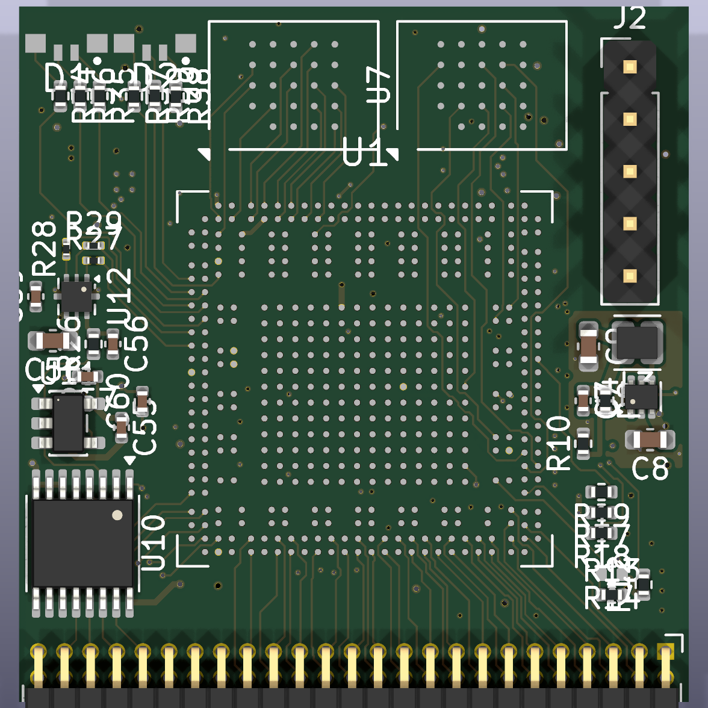
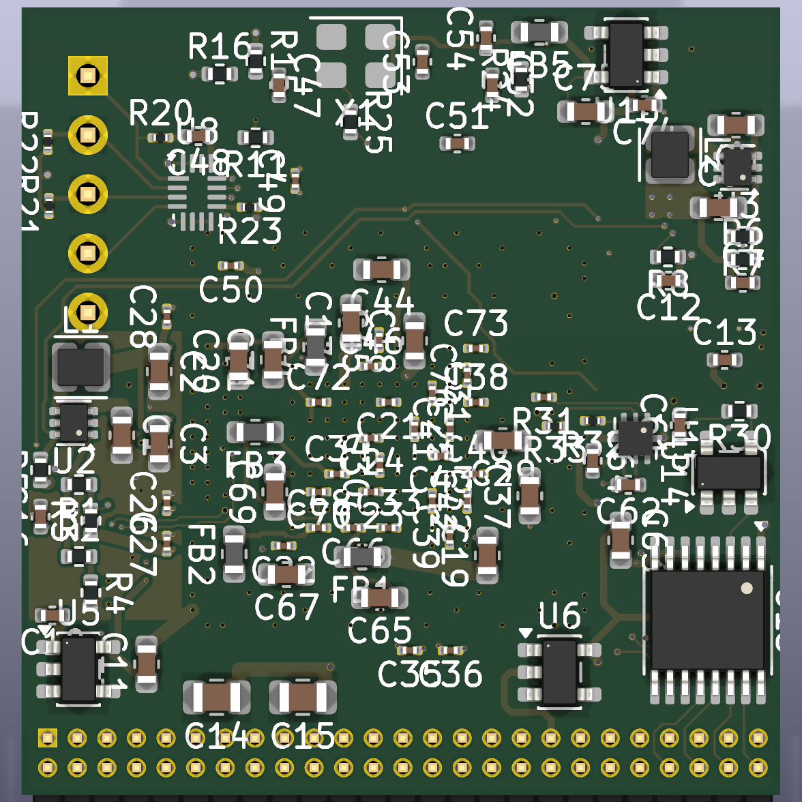

# Agilex 3 control card

A small FPGA control card built around an Altera Agilex 3 (A3CZ065BB18AE7S, B18A BGA), designed in KiCad 10. It plugs
into a power-electronics board through a 2×25 1.27 mm header and replaces an older Cyclone 10 card (U25) with the same
outline and connector positions.

| Top | Bottom |
|---|---|
|  |  |

**Status: work in progress.** The schematic is complete, and the board is placed and almost fully routed. The last
connections are being routed by hand. The board has not been fabricated or tested yet.

## Features

- **FPGA:** Agilex 3 A3CZ065, 65k logic elements, speed grade −7, extended temperature. 63 I/O signals, mostly on 3.3 V HVIO
  banks with no level shifters.
- **Memory:** 32 MB HyperRAM (Winbond W958D8NBYA5I, 1.8 V) on bank 6C. The W959D8NFYA5I (64 MB) fits the same footprint.
- **Configuration:** Active Serial x4 from a 1.8 V QSPI flash (Micron MT25QU256). JTAG on a 5-pin 2.54 mm header,
  shifted from 3.3 V to 1.8 V by an SN74AVC4T774.
- **Clock:** 100 MHz 1.8 V oscillator into PLLREFCLK1 (D18) and the configuration clock input OSC_CLK_1.
- **ADC:** 2 channels, each an 8:1 analog mux (SN74LV4051A) → OPA365 buffer → ADS7056 (14-bit, 2.5 MSPS), on a separate
  analog 3.3 V supply.
- **Power:** from 5 V on the header. Three Diodes AP61x02 bucks (0.75 V core, 1.8 V, 3.3 V) start up in order, each
  enabled by the previous one's power-good. LDOs make 1.2 V, analog 3.3 V and a separate 1.8 V for the HyperRAM bank.
  The FPGA's PLL and ADC supplies are filtered with ferrite beads.
- **Indicators:** 2 RGB LEDs.
- **Board:** 32.5 × 33.8 mm, 6 layers, 1.6 mm, 0.65 mm-pitch BGA fanned out with filled and capped via-in-pad.
  Parts are chosen for JLCPCB assembly on both sides.

## Repository layout

| Path | Contents |
|---|---|
| `hardware/` | KiCad project: schematic (`control_card.kicad_sch` plus `sheets/`), board, design rules (`control_card.kicad_dru` adds JLCPCB limits) |
| `hardware/lib/` | Project symbols and footprints, including the Agilex 3 symbol and the B18A BGA footprint |
| `reference/` | FPGA pin assignment (`pin_assignment.csv`), Altera pin lists, power-board header pinout, JLCPCB part list |
| `docs/` | Design notes, Agilex 3 board requirements, flash requirements, order checklist |
| `tools/` | Python scripts that generated the schematic and board, plus the fabrication-output scripts |

## Documentation

- [`docs/design-notes.md`](docs/design-notes.md): architecture, part choices and the reasons for them.
- [`docs/agilex3_requirements.md`](docs/agilex3_requirements.md): what the FPGA needs from the board (supply rails,
  bank voltages, power-up order, configuration pins) and how this card meets each requirement.
- [`docs/agilex_flash_requirements.md`](docs/agilex_flash_requirements.md): configuration flash requirements.
- [`docs/order_checklist.md`](docs/order_checklist.md): the remaining steps from routing to a JLCPCB order.

## Opening the design

Open `hardware/control_card.kicad_pro` in KiCad 10. The project's own symbol and footprint libraries are set up in
`hardware/sym-lib-table` and `hardware/fp-lib-table`. Everything else comes from KiCad's standard libraries.

## Fabrication outputs

```sh
KICAD_ROOT=<unpacked KiCad AppImage (squashfs-root)> tools/fab_outputs.sh
```

This writes `hardware/fab/`:
- Gerbers and drill files, zipped;
- the JLCPCB BOM and placement files;
- a DRC report.

The headers J1 and J2 are left out of the assembly files, because they are soldered by hand. The FPGA has no JLCPCB
part number, so order it through JLCPCB's Global Sourcing or supply it yourself.

## FPGA pin assignment

`reference/pin_assignment.csv` lists every used FPGA ball with its signal, bank, direction and pin function, generated
from the schematic netlist. Quartus settings:
- banks 6C and 6D: 1.8-V LVCMOS;
- other banks: 3.3-V LVCMOS;
- configuration scheme: Active Serial x4;
- `DEVICE_INITIALIZATION_CLOCK OSC_CLK_1_100MHZ`;
- `ACTIVE_SERIAL_CLOCK AS_FREQ_100MHZ`.

## Generator scripts

The initial schematic and board came from the scripts in `tools/`:
- `gen_schematic.py` writes the schematic;
- `build_pcb.sh` builds the board: placement, FPGA pin assignment, power copper and routing.

The design has since been edited by hand in KiCad, so **don't rerun `gen_schematic.py` or `build_pcb.sh` on this
version**: they would overwrite the hand edits, pin swaps and routing. They stay in the repository as a record of how
the design was made.

## License

[MIT](LICENSE).
